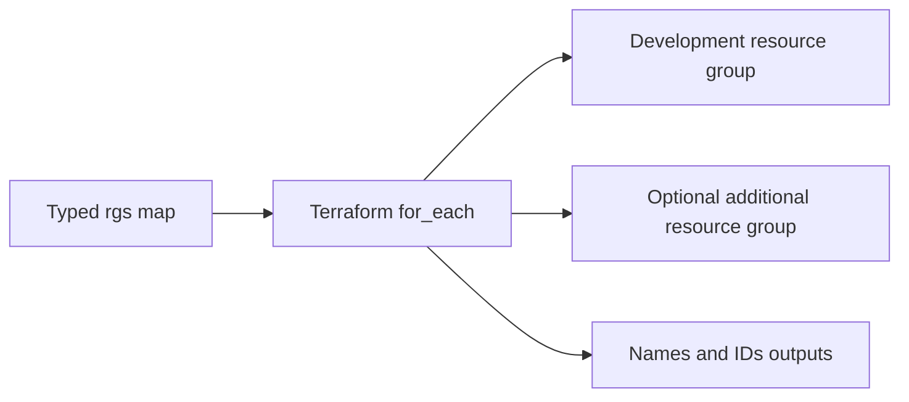

<div align="center">

# Azure Resource Groups with Terraform

**A compact `for_each` example for repeatable resource-group provisioning**

[](https://developer.hashicorp.com/terraform)
[](https://azure.microsoft.com/)

</div>

This learning project creates one or more Azure resource groups from a typed map input. Stable map keys let Terraform manage each resource-group instance independently.

## Example



## Prerequisites

- Terraform `>= 1.5`
- Azure CLI and an Azure subscription
- Azure authentication configured for the AzureRM provider (for example, `az login`)
- An Azure role that permits resource-group creation

## Configure and run

```powershell
Copy-Item terraform.tfvars.example dev.local.tfvars
# Edit the resource-group names and Azure locations.
terraform init
terraform fmt -check
terraform validate
terraform plan -var-file=dev.local.tfvars
```

Review the plan, then apply only when you are ready to create resources:

```powershell
terraform apply
```

The example variable file is safe to customize. Use a separate local file because this repository already contains a tracked legacy `terraform.tfvars`; do not overwrite it. New local `*.tfvars`, Terraform state, and saved plans are excluded by `.gitignore`.

## Outputs and cleanup

Terraform returns a map of Azure resource-group names and IDs. Remove the resources after the exercise:

```powershell
terraform destroy
```

Review the destroy plan before confirming. Resource groups can contain resources beyond this configuration; confirm the planned deletions before proceeding.

## Cost and scope

Resource groups themselves do not normally incur charges, but resources placed inside them do. This example creates only resource groups; it is not a complete Azure landing zone or production deployment.
